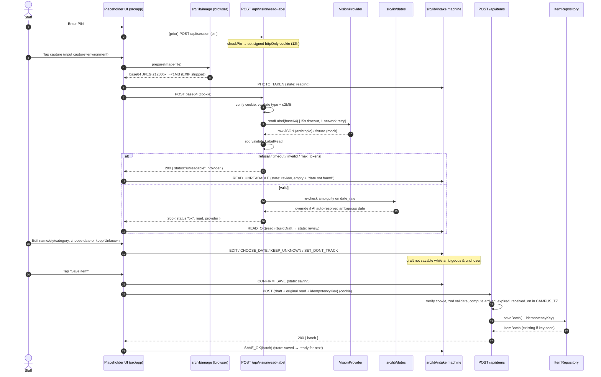

# Design — Pantry Network, Module 1 (Intake)

This design implements the numbered requirements in `requirements.md`. It fixes the architecture, module boundaries, API contracts, the photo → read → confirm → save flow, error states, and the data model. The guiding constraint (R1.3, R9.5): **all behavior lives in `src/lib` and the API routes; `src/app` and `src/components` are a throwaway placeholder UI.**

---

## 1. Architecture overview

```
 Phone browser (placeholder UI, src/app + src/components)
   │  1. PIN               2. capture + resize (src/lib/image, browser)
   │  3. POST base64 JPEG
   ▼
 Next.js API routes (server only)
   ├─ POST   /api/session            PIN check → signed cookie      (src/lib/auth)
   ├─ DELETE /api/session            logout
   ├─ POST   /api/vision/read-label  validate → VisionProvider → zod → date re-check
   ├─ POST   /api/items              zod → repository.saveBatch (idempotent)
   └─ GET    /api/items?since=today  repository.listBatches
   ▼
 src/lib (headless, browser-free, fully tested)
   ├─ auth/     sign + verify session token (HMAC, SESSION_SECRET)
   ├─ image/    browser-side resize + JPEG re-encode (metadata strip)
   ├─ vision/   VisionProvider iface, anthropic + mock providers, prompt, LabelRead zod
   ├─ dates/    parse / normalize / ambiguity detection / tz "today"
   ├─ intake/   state machine + ReviewDraft rules + edited_fields
   ├─ items/    ItemBatch type, taxonomy, zod validation, arrived_expired
   └─ db/       ItemRepository iface, MemoryRepository, SupabaseRepository, selector
   ▼
 Storage:  MemoryRepository (local/test)  |  SupabaseRepository (deployed demo)
```

### Layering rules
- UI imports only typed interfaces from `src/lib` (e.g. `createIntakeMachine`, `prepareImage`, `ItemRepository`). It never imports a concrete provider or the Anthropic SDK.
- Providers and repositories are selected by env at runtime in a small server-only factory, so swapping them needs no code change (R6.3, R13.5).
- The Anthropic SDK and Supabase service-role key are imported only in server files (`src/lib/vision/anthropic.ts`, `src/lib/db/supabase.ts`) that are never bundled to the client.

---

## 2. Modules and components

### 2.1 `src/lib/auth`
- `signSession(payload: { exp: number }): string` — `base64url(payload).base64url(HMAC-SHA256(payload, SESSION_SECRET))`.
- `verifySession(token: string): boolean` — constant-time HMAC compare (R2.5) and `exp` check.
- `SESSION_COOKIE = "pn_session"`; cookie options `{ httpOnly: true, secure: true, sameSite: "lax", maxAge: 12h, path: "/" }`.
- `checkPin(submitted: string): boolean` — constant-time compare against `STAFF_PIN`.
- A shared `requireSession(req)` helper used by middleware and protected routes.

### 2.2 `src/lib/image` (browser)
- `prepareImage(file: File): Promise<{ blob: Blob; base64: string; width: number; height: number; bytes: number }>`.
- Draws the decoded image onto a `<canvas>` scaled so the longest side ≤ 1280 px (R4.1), exports `image/jpeg` quality `0.8` (R4.2). Canvas re-encode strips EXIF/GPS (R4.4). Returns base64 (no data-URI prefix) for upload. Never touches the original bytes for upload (R4.3).
- Guard: if the result still exceeds ~2 MB, lower quality once and re-export; surface `bytes` so the UI can warn.

### 2.3 `src/lib/dates`
- `toISO(d: {y,m,day}): string` and `parseISO(s): {y,m,day}` — round-trip stable (P1/R7.2).
- `detectAmbiguity(raw: string): { ambiguous: boolean; candidates: string[]; precision: "day"|"month"|null }`:
  - Numeric date with two components both ≤ 12 and different → `ambiguous: true`, candidates `[monthFirstISO, dayFirstISO]` in that order (R7.4), never auto-resolved (P2/R7.3).
  - Month+year only → last day of month, `precision: "month"` (R7.5/P7).
  - Otherwise a single ISO.
- `spellOut(iso: string): string` → e.g. `"12 June 2027"`. Used to build the two labelled choices (month-first label first).
- `todayInTz(tz: string): string` and `isoBefore(a, b): boolean` — compute "today"/`received_on` and expiry comparison in `CAMPUS_TZ` via `Intl.DateTimeFormat` (R7.7). No UTC.

### 2.4 `src/lib/vision`
> **Plan change:** Gemini is the active provider (free tier, fastest path to real phone testing). Anthropic is implemented and kept for later but inactive.
- `LabelRead` zod schema (R10.1) — see §6.1. Also a JSON Schema export (zod 4 native `z.toJSONSchema`) for the provider's structured-output config.
- `interface VisionProvider { readonly name: "gemini" | "anthropic" | "mock"; readLabel(imageJpegBase64: string): Promise<LabelRead>; }` (R6.1).
- `GeminiVisionProvider` (§5), `AnthropicVisionProvider` (§5, kept for later), `MockVisionProvider` (returns fixtures keyed deterministically; default when no key, used by all tests — R6.12).
- `getVisionProvider(): VisionProvider` — reads `VISION_PROVIDER` (default `gemini`); if the selected real provider's key is missing, logs a startup warning (R6.14) and returns the mock (R6.4).
- `applyServerRechecks(read)` — normalizes category and re-runs date ambiguity on `date_raw`, overriding any AI-resolved ambiguous date (R5.13).
- `SYSTEM_PROMPT` — the verbatim brief prompt; its taxonomy list is generated from `taxonomy.ts` so the two can't drift (R6.11).

### 2.5 `src/lib/intake` (headless state machine)
- States: `idle → reading → review → saving → saved`; plus `review` entered on `unreadable` (empty fields) and on error (with message) (R8.1–R8.3).
- `buildDraft(read: LabelRead, now: {today, tz}): ReviewDraft` applies all rules R8.5–R8.13.
- Events: `PHOTO_TAKEN`, `READ_OK(read)`, `READ_UNREADABLE`, `READ_ERROR(msg)`, `EDIT(patch)`, `CHOOSE_DATE(iso)`, `KEEP_UNKNOWN`, `SET_DONT_TRACK(bool)`, `CONFIRM_SAVE`, `SAVE_OK(batch)`, `SAVE_ERROR(msg)`, `RESET`.
- Invariants enforced in the reducer (not the UI):
  - No transition to `saving` except via `CONFIRM_SAVE` from `review` with a valid draft (R8.14/P8).
  - A draft with `date_ambiguous && chosenDate == null && !dontTrack && !doesntExpire` is **not savable**; `expires_on` stays `null` until `CHOOSE_DATE` or `KEEP_UNKNOWN` (R8.7/R8.15/P8).
  - `dont_track` or `doesnt_expire` ⇒ `expires_on = null`, date fields disabled/hidden (R8.8/R8.9/P6).
- `computeEditedFields(original: LabelRead, draft: ReviewDraft): string[]` (R8.13).
- `date_source`: `"photo"` if the read date is kept unchanged, `"typed"` if staff changed it (R8.12).

### 2.6 `src/lib/items`
- `taxonomy.ts` — the groups/values from the brief; `CATEGORY_VALUES`, `CATEGORY_GROUP[value]`, and `normalizeCategory(raw): value | "Uncategorized"` (case-insensitive, R10.2/R10.3/P5).
- `ItemBatch` type and `itemBatchSchema` (zod) for `POST /api/items` input/output (R11.2).
- `computeArrivedExpired(expires_on, received_on): boolean` — true iff `expires_on` non-null and before `received_on` (R11.9/P9).

### 2.7 `src/lib/db`
- `interface ItemRepository { name: "memory"|"supabase"; saveBatch(input): Promise<ItemBatch>; listBatches(campusId, since): Promise<ItemBatch[]>; }` (R13.1).
- `saveBatch` takes an `idempotencyKey`; the repo returns the existing batch if the key was already used (R11.10).
- `MemoryRepository` — module-level map seeded with fake Campus A items; keyed idempotency map.
- `SupabaseRepository` — server-only `@supabase/supabase-js` with the service-role key; `saveBatch` inserts into `items`, then inserts the `intake_reads` record. Dedup is driven by the partial unique index `items_campus_idempotency_key` on `(campus_id, idempotency_key)`: when the insert violates it (Postgres error `23505`), the repository selects and returns the existing row for that `(campus_id, idempotency_key)` instead of creating a second batch, and skips the paired `intake_reads` insert (R11.10). A null/absent idempotency key never triggers dedup (it is excluded from the index), so unkeyed saves always insert.
- `getRepository(): ItemRepository` — returns Supabase when both env vars are set, else Memory (R13.5/R13.6).

### 2.8 Placeholder UI (`src/app`, `src/components/intake`)
- `/` redirects to `/intake` (R1.4). `/pin` posts to `/api/session`. `/intake` holds the capture button + review form, driven entirely by the `src/lib/intake` machine. `/intake/today` lists batches and shows the active repo + demo-mode banner. Plain HTML + minimal Tailwind, labelled inputs, real buttons (R1.6/R9.4). Deleting these folders leaves all `src/lib` tests green (R1.3/R18.5).

---

## 3. Photo → read → confirm → save sequence



---

## 4. Error states

| Source | Condition | Behavior |
|---|---|---|
| `/api/session` | wrong PIN | 401, no cookie (R2.4) |
| protected route/page | missing/invalid cookie | 401 (API) / redirect `/pin` (page) (R2.6) |
| read-label | not a JPEG / > 2 MB | 400 before provider call (R5.2/R5.3) |
| read-label | provider throws / times out (15s) / network | retry once on network only (R5.10); else `unreadable` |
| read-label | `stop_reason` refusal or max_tokens | `unreadable` (R6.10) |
| read-label | zod fails | `unreadable` (R5.7/P4) — never 500 (R5.9) |
| intake machine | save attempted while ambiguous+unchosen | blocked; stays in `review` (R8.15/P8) |
| items | empty name / qty out of 1..999 | 400 (R11.3/P3) |
| items | duplicate idempotency key | 200 with existing batch (R11.10) |
| items | repository error | 500 with generic message (persistence is not "fail soft" like vision) |

Already-expired (not an error): if `expires_on` < today (campus tz), show "This date has passed", still savable, `arrived_expired = true` (R9.3a/R11.9).

Demo mode (not an error): `provider === "mock"` ⇒ UI banner "Demo mode: sample reads" (R5.8a).

---

## 5. Vision call

> **Active provider: Gemini.** Anthropic (below) is kept for later.

### 5a. Gemini vision call (active — grounded in current docs, ai.google.dev 2026-10)

Request with `@google/genai`:

```ts
import { GoogleGenAI } from "@google/genai";
const ai = new GoogleGenAI({ apiKey: process.env.GEMINI_API_KEY });
const response = await ai.models.generateContent({
  model: process.env.VISION_MODEL ?? "gemini-3.8-flash",
  contents: [
    { inlineData: { mimeType: "image/jpeg", data: imageJpegBase64 } },
    { text: "Read this one item. Return only the JSON object." },
  ],
  config: {
    systemInstruction: SYSTEM_PROMPT,                 // R6.11
    responseMimeType: "application/json",             // structured output (R6.6)
    responseJsonSchema: LABEL_READ_JSON_SCHEMA,       // zod 4 z.toJSONSchema
  },
});
```

Response handling:
- `finishReason` other than `"STOP"`, or empty `response.text` → unreadable (R6.10).
- Else `JSON.parse(response.text)` then `labelReadSchema.parse(...)`. Any failure → unreadable (R5.7).
- Log `usageMetadata.promptTokenCount` / `candidatesTokenCount` (R5.11).
- 15s timeout via `Promise.race` with a timeout; one retry only on a network error (R5.5, R5.10).

Key facts confirmed from the docs (not memory): the SDK is `@google/genai`; `gemini-3.8-flash` is a current, multimodal model that accepts inline image input on the free tier; structured output is `responseMimeType` + `responseJsonSchema` (standard JSON Schema). Free-tier privacy caveat → R6.15.

### 5b. Anthropic vision call (kept for later — grounded in current docs)

Request to `messages.create` with `@anthropic-ai/sdk`:

```ts
const res = await client.messages.create({
  model: process.env.VISION_MODEL ?? "claude-haiku-5-5",
  max_tokens: 1024,
  system: SYSTEM_PROMPT,                 // verbatim brief prompt (R6.11)
  messages: [{
    role: "user",
    content: [
      { type: "image",
        source: { type: "base64", media_type: "image/jpeg", data: imageJpegBase64 } },
      { type: "text", text: "Read this one item. Return only the JSON object." },
    ],
  }],
  output_config: {
    effort: "low",                       // lowest effort for extraction (R6.7)
    format: { type: "json_schema", schema: LABEL_READ_JSON_SCHEMA }, // structured outputs (R6.6)
  },
  // NO temperature / top_p / top_k — Haiku 5.5 rejects them (R6.8)
  // NO assistant prefill — rejected (R6.9)
});
```

Response handling:
- If `res.stop_reason` is `"refusal"` or `"max_tokens"` → throw `Unreadable` (→ `unreadable`) (R6.10).
- Else take the JSON from the response's structured text block, `JSON.parse`, then `LabelRead.parse` (zod). Any failure → `unreadable`.
- Log `res.usage.input_tokens` / `res.usage.output_tokens` to the server console (R5.11).
- Retry wrapper: one retry only on a network/connection error (R5.10), each attempt under the 15s timeout (R5.5) via `AbortSignal.timeout`.

**Schema complexity budget (from docs):** structured outputs cap union-typed params at 16. `LabelRead` nullable fields: `name, brand, size_text, date_raw, expires_on, date_precision, quantity_visible, notes` = 8 `["T","null"]` unions, plus `date_type` (enum, not a union) and `category` (enum). 8 ≤ 16 — within budget. All fields are marked `required` (nulls carried explicitly) so property ordering is preserved and the optional-param limit (24) is not a concern.

> **Divergences from the brief, flagged per working-instruction #5:** the brief says "use the API's structured-output feature / lowest reasoning effort." The current docs make these concrete and add constraints: structured outputs use `output_config.format` (not tool-use/prefill); effort is `output_config.effort: "low"`; `temperature/top_p/top_k` must be omitted; refusals/max_tokens must be handled as unreadable; enum casing isn't guaranteed (category normalized case-insensitively). Model ID `claude-haiku-5-5` is unchanged.

---

## 6. Data model

### 6.1 LabelRead (zod + JSON Schema for the vision call) — R10.1

```ts
const DateType = z.enum(["use_by","best_by","sell_by","unlabeled","none"]);
const LabelRead = z.object({
  name: z.string().nullable(),
  brand: z.string().nullable(),
  size_text: z.string().nullable(),
  category: z.string(),                       // normalized to taxonomy|"Uncategorized" after parse (R10.2/R10.3)
  is_food: z.boolean(),
  doesnt_expire: z.boolean(),
  perishable: z.boolean(),
  date_raw: z.string().nullable(),
  date_type: DateType,
  expires_on: z.string().regex(/^\d{4}-\d{2}-\d{2}$/).nullable(),
  date_precision: z.enum(["day","month"]).nullable(),
  date_ambiguous: z.boolean(),
  date_candidates: z.array(z.string()),       // ISO, empty unless ambiguous
  quantity_visible: z.number().int().nullable(),
  name_confidence: z.number().min(0).max(1),
  date_confidence: z.number().min(0).max(1),
  notes: z.string().nullable(),
});
```

### 6.2 ReviewDraft (headless, in `src/lib/intake`)

```ts
type DeliverySource = "donated" | "purchased" | null;
interface ReviewDraft {
  name: string;                 // required non-empty to save (R8.5)
  brand: string | null;
  size_text: string | null;
  category: string;             // taxonomy value | "Uncategorized"
  category_group: string;
  quantity: number;             // int 1..999 (R8.10)
  expires_on: string | null;    // null while ambiguous+unchosen, or Unknown
  date_type: "use_by"|"best_by"|"sell_by"|"unlabeled"|"none";
  date_precision: "day"|"month"|null;
  date_source: "photo"|"typed"|null;     // R8.12
  date_ambiguous: boolean;
  date_candidates: string[];             // [monthFirstISO, dayFirstISO]
  date_choices: { iso: string; label: string }[]; // month-first label first (R7.4)
  chosen_date: string | null;
  dont_track: boolean;          // clears+disables date (R8.9)
  doesnt_expire: boolean;       // hides+nulls date (R8.8)
  perishable: boolean;
  source: DeliverySource;       // null = not set
  arrived_expired: boolean;     // R11.9
  note: string | null;          // "date not found" / "This date has passed"
}
```

### 6.3 ItemBatch (saved) and intake_read

```ts
interface ItemBatch {
  id: string; campus_id: string;
  name: string; brand: string|null; size_text: string|null;
  category: string; category_group: string;
  quantity: number; unit: "each";
  received_on: string;               // CAMPUS_TZ date
  expires_on: string|null;
  date_type: string|null; date_precision: string|null;
  date_source: "photo"|"typed"|"imported"|"estimated"|null;
  dont_track: boolean; doesnt_expire: boolean; perishable: boolean;
  arrived_expired: boolean;
  source: "donated"|"purchased"|null;
  cost: number|null;                 // not collected this module
  created_at: string;
}
interface IntakeRead {
  id: string; item_id: string; model: string;
  read_name: string|null; read_date_raw: string|null; read_expires_on: string|null;
  name_confidence: number|null; date_confidence: number|null;
  edited_fields: string[]; created_at: string;
}
```

### 6.4 SQL migration (`supabase/migrations/001_items.sql`, not executed — R13.7)

```sql
create extension if not exists "pgcrypto";

create table items (
  id uuid primary key default gen_random_uuid(),
  campus_id text not null,
  idempotency_key text,
  name text not null,
  brand text, size_text text,
  category text, category_group text,
  quantity int not null check (quantity between 1 and 999),
  unit text default 'each',
  received_on date default current_date,
  expires_on date,
  date_type text, date_precision text,
  date_source text check (date_source in ('photo','typed','imported','estimated')),
  dont_track boolean default false,
  doesnt_expire boolean default false,
  perishable boolean default false,
  arrived_expired boolean default false,
  source text check (source in ('donated','purchased')),
  cost numeric,
  created_at timestamptz default now()
);

-- Dedupe saves per campus by idempotency key. Partial index so rows with a
-- null key (none supplied) never collide; only real keys are unique.
create unique index items_campus_idempotency_key
  on items (campus_id, idempotency_key)
  where idempotency_key is not null;

create table intake_reads (
  id uuid primary key default gen_random_uuid(),
  item_id uuid references items(id) on delete cascade,
  model text,
  read_name text, read_date_raw text, read_expires_on date,
  name_confidence numeric, date_confidence numeric,
  edited_fields text[],
  created_at timestamptz default now()
);

-- RLS on; policies arrive with user accounts (future module).
alter table items enable row level security;
alter table intake_reads enable row level security;
```

---

## 7. API contract (also mirrored in README.md — R17.3)

All protected routes require the `pn_session` cookie. All bodies are JSON unless noted.

### POST /api/session
Request: `{ "pin": "1234" }`
- 200 `{ "ok": true }` + `Set-Cookie: pn_session=...; HttpOnly; Secure; SameSite=Lax; Max-Age=43200`
- 401 `{ "ok": false, "error": "invalid_pin" }`

### DELETE /api/session
- 200 `{ "ok": true }` + cookie cleared.

### POST /api/vision/read-label
Request: `{ "imageBase64": "<jpeg base64, no data: prefix>" }`  (≤ 2 MB decoded)
- 200 ok:
```json
{ "status": "ok", "provider": "anthropic",
  "read": { "name": "Black beans, canned, 15 oz", "brand": "Goya", "size_text": "15 oz",
    "category": "Canned Goods", "is_food": true, "doesnt_expire": false, "perishable": false,
    "date_raw": "BEST BY 06/2027", "date_type": "best_by", "expires_on": "2027-06-30",
    "date_precision": "month", "date_ambiguous": false, "date_candidates": [],
    "quantity_visible": null, "name_confidence": 0.92, "date_confidence": 0.8, "notes": null } }
```
- 200 unreadable: `{ "status": "unreadable", "provider": "mock" }`
- 400 `{ "error": "bad_image" }` (wrong type or > 2 MB)
- 401 `{ "error": "unauthorized" }`

### POST /api/items
Request:
```json
{ "idempotencyKey": "uuid-from-client",
  "batch": { "name": "Black beans, canned, 15 oz", "brand": "Goya", "size_text": "15 oz",
    "category": "Canned Goods", "quantity": 12, "expires_on": "2027-06-30",
    "date_type": "best_by", "date_precision": "month", "date_source": "photo",
    "dont_track": false, "doesnt_expire": false, "perishable": false, "source": "donated" },
  "read": { "...": "the original LabelRead, for the intake_reads record" },
  "editedFields": ["quantity"] }
```
- 200 `{ "batch": { "id": "…", "campus_id": "campus-a", "received_on": "2026-10-24",
  "arrived_expired": false, "edited_fields": ["quantity"], "...": "…" } }`
- 400 `{ "error": "invalid_batch", "details": [ … zod issues … ] }`
- 401 `{ "error": "unauthorized" }`

### GET /api/items?since=today
- 200 `{ "repository": "supabase", "campusId": "campus-a", "items": [ ItemBatch, … ] }`
- 401 `{ "error": "unauthorized" }`

---

## 8. Configuration (env)

| Var | Default | Used by | Notes |
|---|---|---|---|
| `STAFF_PIN` | — | server | PIN gate; may be public to judges |
| `SESSION_SECRET` | — | server | HMAC key for the session token |
| `CAMPUS_ID` | `campus-a` | server | stamps batches |
| `CAMPUS_TZ` | `America/New_York` | server | "today" + received_on |
| `VISION_PROVIDER` | `gemini` | server | `gemini` \| `anthropic` \| `mock` |
| `VISION_MODEL` | `gemini-3.8-flash` | server | model ID for the selected provider |
| `GEMINI_API_KEY` | — | server | active provider; absent ⇒ mock + startup warning |
| `ANTHROPIC_API_KEY` | — | server | kept for later; used only if `VISION_PROVIDER=anthropic` |
| `SUPABASE_URL` | — | server | both set ⇒ Supabase repo (deployed demo) |
| `SUPABASE_SERVICE_ROLE_KEY` | — | server | server only, never `NEXT_PUBLIC_` |

No secret ever uses a `NEXT_PUBLIC_` prefix (R14.1).

---

## 9. Test strategy (mock provider only — R15)

- `dates`: P1 round-trip, P2 ambiguity (incl. the AI-resolved override path), P7 month→last-day.
- `items`: P3 name+quantity acceptance/rejection, P5 category normalization, P9 arrived_expired.
- `intake`: P6 dont_track/doesnt_expire ⇒ null expiry, P8 no `saving` without confirm + no unchosen-ambiguous save; unit: edited_fields.
- `vision`/route: P4 schema-fail ⇒ `unreadable`; unit: refusal/max_tokens ⇒ unreadable.
- `auth`: unit PIN gate (right/wrong/constant-time path), cookie verify.
- route/`image`: unit image size rejection (> 2 MB) and type rejection; double-submit idempotency.
- No visual/snapshot tests for the placeholder UI (R15.11).

Property tests use `fast-check` generators (arbitrary dates, quantities, LabelRead shapes, event sequences). All vision tests use `MockVisionProvider`; none hit the network.
